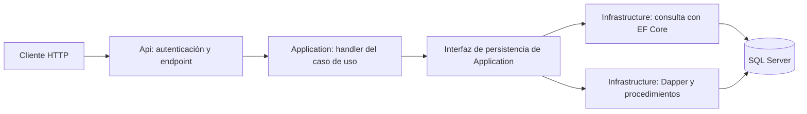

# ProductInventory — API de inventario con .NET 9
API REST para gestionar productos, categorías, proveedores y movimientos de inventario IN/OUT. Incluye 17 casos de uso, autenticación con Keycloak y un entorno Docker Compose con SQL Server.
## Requisitos
Para compilar y ejecutar la API localmente necesitas:

- **.NET 9 SDK** solo si vas a ejecutar las pruebas o desarrollar desde el equipo. Para ejecutar la API con Docker Compose, el SDK y el runtime están incluidos en las imágenes y no necesitas instalarlos localmente. Descárgalo desde la [página oficial de .NET 9](https://dotnet.microsoft.com/download/dotnet/9.0). El proyecto apunta a `net9.0` y no fija una versión puntual del SDK.
- **Git**, para clonar el repositorio, y **acceso a Internet** durante `dotnet restore` para descargar paquetes de NuGet.

Para trabajar desde Visual Studio en Windows, instala **Visual Studio 2022 17.12 o posterior** con la carga de trabajo **ASP.NET y desarrollo web** y las **herramientas de desarrollo de contenedores**. También puedes ejecutar Compose desde PowerShell o CMD, sin Visual Studio.

Para iniciar los servicios locales y ejecutar las pruebas de integración necesitas **Docker Desktop** con Docker Engine y Docker Compose v2 disponibles. Compose ya viene incluido en Docker Desktop; no hace falta instalar Docker Compose por separado. Descarga Docker Desktop desde su [página oficial](https://www.docker.com/products/docker-desktop/) y consulta la [guía oficial de instalación de Compose](https://docs.docker.com/compose/install/). El entorno Compose levanta SQL Server, Keycloak y la API. Las pruebas de integración usan SQL Server real y requieren permiso `CREATE DATABASE`.

Comprueba la instalación con `docker --version` y `docker compose version`; para ejecutar pruebas locales, comprueba también `dotnet --list-sdks`. La primera construcción requiere acceso a los registros de imágenes y a NuGet.
## Tecnologías

- [ASP.NET Core 9 — Minimal APIs](https://learn.microsoft.com/aspnet/core/fundamentals/minimal-apis/overview?view=aspnetcore-9.0): API REST sobre .NET 9.
- [Entity Framework Core 9](https://learn.microsoft.com/ef/core/): consultas y proyecciones de solo lectura.
- [Dapper](https://github.com/DapperLib/Dapper#readme): llamadas parametrizadas a procedimientos almacenados para escrituras.
- [SQL Server 2022](https://learn.microsoft.com/sql/sql-server/?view=sql-server-ver16): base de datos relacional.
- [Microsoft.Data.SqlClient](https://learn.microsoft.com/sql/connect/ado-net/introduction-microsoft-data-sqlclient-namespace): conexiones ADO.NET a SQL Server.
- [Keycloak 26.8.2](https://www.keycloak.org/documentation): proveedor de identidad OAuth2/OpenID Connect.
- [ASP.NET Core JWT Bearer](https://learn.microsoft.com/aspnet/core/security/authentication/configure-jwt-bearer-authentication?view=aspnetcore-9.0): validación de tokens para proteger las rutas de negocio.
- [Swashbuckle.AspNetCore — Swagger/OpenAPI](https://github.com/domaindrivendev/Swashbuckle.AspNetCore#readme): documentación interactiva con Authorization Code y PKCE.
- [xUnit.net 2](https://xunit.net/docs/getting-started/v2/netcore/cmdline) y [Moq 4](https://github.com/devlooped/moq#readme): pruebas unitarias y dobles de prueba, con aserciones nativas de xUnit.
- [WebApplicationFactory](https://learn.microsoft.com/aspnet/core/test/integration-tests?view=aspnetcore-9.0): pruebas de integración HTTP; las pruebas de persistencia utilizan SQL Server real.
- [Coverlet](https://github.com/coverlet-coverage/coverlet#readme): recolección de cobertura de pruebas mediante `coverlet.collector`.
- [Docker](https://docs.docker.com/) y [Docker Compose](https://docs.docker.com/compose/): contenedores y ejecución conjunta de la API, SQL Server y Keycloak.

La aplicación implementa CQRS manual con comandos, consultas y handlers explícitos. Actualmente no incluye frontend, Aspire, MediatR, AutoMapper, FluentValidation, NUnit, Shouldly, Respawn ni Scalar.

## Estructura del repositorio
El repositorio separa el código ejecutable, la documentación del proyecto y los recursos para el entorno local. La solución, sus siete proyectos .NET y el proyecto Docker Compose viven en `code/`. El siguiente árbol resume los archivos y carpetas principales; omite artefactos generados, configuraciones privadas y carpetas vacías.

```text
ProductInventory/
├── code/
│   ├── ProductInventory.sln
│   ├── docker-compose.dcproj
│   ├── docker-compose.yml
│   ├── docker-compose.override.yml
│   ├── launchSettings.json
│   ├── .env.example
│   ├── Directory.Build.props
│   ├── Directory.Packages.props
│   ├── .dockerignore
│   ├── .editorconfig
│   ├── integration.runsettings.example
│   ├── src/
│   │   ├── ProductInventory.Api/
│   │   ├── ProductInventory.Application/
│   │   ├── ProductInventory.Domain/
│   │   └── ProductInventory.Infrastructure/
│   └── tests/
│       ├── ProductInventory.Domain.Tests/
│       ├── ProductInventory.Application.Tests/
│       └── ProductInventory.IntegrationTests/
├── docs/
│   ├── adr/
│   │   └── es/
│   └── implementation/
├── infra/
│   ├── .env.example
│   ├── README.md
│   └── keycloak/
│       ├── README.md
│       └── productinventory-realm.json
├── specs/
│   ├── README.md
│   ├── requirements_catalog.md
│   ├── entity_model.md
│   ├── traceability.md
│   ├── vision.md
│   ├── use_cases.puml
│   └── usecases/
├── .gitignore
├── AGENTS.md
├── constraints.md
└── README.md
```

- **`code/src/ProductInventory.Api/`**: aplicación ASP.NET Core. `Features/` mapea rutas HTTP y enlaza solicitudes con handlers; `Security/` configura JWT Bearer; `Documentation/` configura OpenAPI y Swagger; `Hosting/` registra dependencias y configura el host; `Errors/` traduce excepciones a respuestas HTTP. Aquí también está el Dockerfile de la API.
- **`code/src/ProductInventory.Application/`**: casos de uso CQRS manuales. Contiene comandos, consultas, handlers, DTOs y puertos de persistencia. Depende de Domain y no contiene acceso directo a SQL ni referencias a Infrastructure.
- **`code/src/ProductInventory.Domain/`**: entidades, reglas e invariantes de negocio. Se mantiene independiente de ASP.NET Core, EF Core, Dapper y SQL Server.
- **`code/src/ProductInventory.Infrastructure/`**: adaptadores de persistencia. Implementa las lecturas con EF Core y las escrituras con Dapper; contiene el acceso a SQL Server y las implementaciones de los puertos de Application.
- **`code/tests/ProductInventory.Domain.Tests/`**: pruebas unitarias de entidades e invariantes del dominio.
- **`code/tests/ProductInventory.Application.Tests/`**: pruebas unitarias de handlers, validaciones y puertos de aplicación.
- **`code/tests/ProductInventory.IntegrationTests/`**: pruebas HTTP y de persistencia contra SQL Server real; no usa una base de datos en memoria.
- **`code/Directory.Build.props` y `code/Directory.Packages.props`**: centralizan propiedades de compilación, framework destino y versiones de paquetes NuGet. **`code/.editorconfig`** aplica convenciones de formato al árbol `code/`.
- **`code/.dockerignore`**: excluye archivos del contexto de construcción de la imagen. **`code/integration.runsettings.example`** es la plantilla para configurar la conexión de las pruebas desde Visual Studio.
- **`infra/` y `code/docker-compose.yml`**: configuración y guías para el entorno local. `infra/keycloak/` guarda la configuración del realm de desarrollo. Los secretos se proporcionan por variables de entorno o `.env` local ignorado por Git.
- **`code/.env.example`**: plantilla principal para preparar el `.env` de Docker Compose. También existe una plantilla anterior en `infra/.env.example`.
- **`specs/`**: visión, requisitos, modelo de entidades, trazabilidad, diagrama de casos de uso y los 17 casos de uso aprobados. **`docs/adr/`** contiene las decisiones arquitectónicas aceptadas y **`docs/adr/es/`**, sus traducciones al español.
- **`docs/implementation/`**: documentación y evidencias locales de implementación; actualmente no está versionada.
- **`AGENTS.md` y `constraints.md`**: instrucciones de trabajo y restricciones técnicas del proyecto.

Los archivos locales `code/.env` y `code/integration.local.runsettings`, junto con `.vs/`, `bin/` y `obj/`, están ignorados por Git. La carpeta `.github/workflows/` existe, pero actualmente está vacía; no hay pipelines configurados ni una carpeta `pipelines/`.

Las dependencias entre proyectos siguen esta dirección: `Domain` no depende de otros proyectos; `Application` depende de `Domain`; `Infrastructure` implementa los puertos de `Application`; y `Api` compone las capas externas.
## Arquitectura y alcance

ProductInventory es una API REST para administrar un inventario de productos. Se despliega como una sola aplicación y organiza su código en cuatro capas siguiendo Clean Architecture: las reglas de negocio permanecen independientes de HTTP, la base de datos y las herramientas de persistencia.

### Responsabilidad de cada capa

| Proyecto | Responsabilidad | Dependencias de proyectos |
|---|---|---|
| `Domain` | Entidades `Product`, `Category`, `Supplier` y `StockMovement`, con sus reglas e invariantes. | Ninguna |
| `Application` | Casos de uso: comandos, consultas, handlers, DTOs e interfaces para solicitar lecturas y escrituras. | `Domain` |
| `Infrastructure` | Implementación de esas interfaces mediante EF Core, Dapper y SQL Server; conexiones e inicialización del esquema. | `Application` y `Domain` |
| `Api` | Endpoints HTTP, autenticación JWT, Swagger y registro de dependencias. Delega los casos de uso en Application. | `Application` e `Infrastructure` |

Application define qué operaciones de persistencia necesita; Infrastructure implementa cómo realizarlas. Api conecta las implementaciones mediante inyección de dependencias. Los endpoints no acceden directamente a SQL.

### Flujo de una operación

La aplicación utiliza CQRS manual: separa las consultas de las operaciones que modifican datos, con handlers explícitos y una sola base de datos SQL Server.



El diagrama muestra el flujo de ejecución. La dependencia de código se mantiene hacia el interior: Infrastructure implementa las interfaces de Application, y Application depende únicamente de Domain. Los handlers coordinan las operaciones y utilizan las entidades del dominio para aplicar las reglas de negocio.

Por ejemplo, al registrar una salida de inventario, el handler valida la solicitud y delega la persistencia en Infrastructure. El writer invoca mediante Dapper el procedimiento `dbo.InventoryMovement_Register`, que actualiza las existencias de forma condicional e inserta el movimiento en una misma transacción. El procedimiento controla el commit/rollback y registra la fecha UTC; el writer traduce el resultado al contrato de Application. Si no hay existencias suficientes o falla el registro, no se guarda ninguno de los dos cambios. Las operaciones concurrentes tampoco pueden dejar existencias negativas ni perder actualizaciones.

### Procedimientos de escritura

Los cuatro writers utilizan `CommandType.StoredProcedure`; las lecturas conservan EF Core. Las definiciones SQL están versionadas y embebidas en `code/src/ProductInventory.Infrastructure/Persistence/Schema/`:

| Operación | Procedimientos |
|---|---|
| Categorías | `Category_Create`, `Category_Update`, `Category_Delete` |
| Proveedores | `Supplier_Create`, `Supplier_Update`, `Supplier_Delete` |
| Productos | `Product_Create`, `Product_Update`, `Product_Delete` |
| Movimientos | `InventoryMovement_Register` |

Todos pertenecen al esquema `dbo`. Las creaciones y actualizaciones devuelven las columnas de sus DTO; los borrados devuelven un booleano escalar. El procedimiento de movimientos devuelve el movimiento confirmado y un parámetro de salida con el resultado de la operación.

Con `Database__Initialize=true`, la aplicación aplica los scripts en orden de nombre dentro de una transacción y conserva el bloqueo de inicialización hasta terminar. `001_initial.sql` prepara las tablas y los scripts siguientes instalan o actualizan los diez procedimientos con `CREATE OR ALTER`, sin eliminar los datos existentes. Al reconstruir e iniciar Compose se realiza este paso automáticamente. Si deshabilitas la inicialización, despliega previamente todos los scripts, no solo `001_initial.sql`.

Despliega los procedimientos junto con la versión de la aplicación que los utiliza. La inicialización requiere permisos DDL; una instancia con base preparada necesita `SELECT` para EF y `EXECUTE` sobre los procedimientos utilizados. El Compose de desarrollo conserva su configuración actual de permisos. Esta separación permite reutilización y ajustes futuros; no implica una mejora de rendimiento medida. La decisión se documenta en [ADR-002](docs/adr/ADR-002-cqrs-persistence.md) y [ADR-003](docs/adr/ADR-003-domain-and-inventory.md).

### Funciones incluidas

El alcance aprobado comprende 17 casos de uso:

- **Productos:** crear, consultar por identificador, listar con paginación, actualizar y eliminar cuando no tengan movimientos. Cada producto pertenece a una categoría y tiene un proveedor principal. El listado permite filtrar por categoría, proveedor y existencias máximas.
- **Categorías y proveedores:** crear, consultar por identificador, listar con paginación, actualizar y eliminar cuando no tengan productos asociados.
- **Inventario:** registrar entradas `IN` y salidas `OUT` con cantidad entera positiva. Cada producto inicia con cero existencias, y solo estos movimientos pueden modificarlas. Se conserva un historial inmutable con fecha UTC y existencias anteriores y posteriores.
- **Acceso protegido:** todas las operaciones de negocio requieren un token OAuth2 válido emitido por Keycloak. La API valida firma, emisor, audiencia y vigencia. Swagger permite iniciar sesión con Authorization Code y PKCE; `/health` es público.

### Límites del proyecto

El proyecto entrega una API, sin frontend de negocio. No gestiona compras, ventas, reservas, múltiples almacenes, usuarios ni roles propios. Los movimientos se registran y conservan, pero no se exponen operaciones para consultar su historial, editarlos o eliminarlos. Tampoco se permite eliminar productos con movimientos ni borrar datos relacionados en cascada.

Los requisitos y casos de uso están en [specs/requirements_catalog.md](specs/requirements_catalog.md) y [specs/usecases/](specs/usecases/). El [modelo de entidades](specs/entity_model.md) describe las relaciones de negocio. Las decisiones técnicas se documentan en [docs/adr/](docs/adr/), con traducciones al español en [docs/adr/es/](docs/adr/es/); las restricciones del assessment se encuentran en [constraints.md](constraints.md).

## Restauración, compilación y pruebas
Ejecuta los comandos desde `code/`, con Docker Desktop iniciado y el motor de contenedores Linux disponible. Desde la raíz, entra primero con `cd code` (PowerShell o CMD).

### Preparar el archivo .env

Copia la plantilla si todavía no tienes `.env`:

PowerShell (terminal o script `.ps1`, desde `code/`):

```powershell
if (-not (Test-Path .env)) { Copy-Item .env.example .env }
```

CMD:

```bat
if not exist .env copy .env.example .env
```

Completa `SQL_SERVER_PASSWORD`, `KEYCLOAK_ADMIN_PASSWORD` y `KEYCLOAK_DEVELOPMENT_PASSWORD` con contraseñas locales diferentes. Para SQL usa una contraseña fuerte de al menos 12 caracteres, con mayúsculas, minúsculas, números y símbolos; evita punto y coma y comillas. Conserva los puertos predeterminados o ajústalos si están ocupados. Si `.env` ya existe, agrega únicamente las claves que falten. No lo publiques en Git.

### Referencia de configuración de la API

El archivo [appsettings.json](code/src/ProductInventory.Api/appsettings.json) muestra las claves de configuración y ejemplos para el entorno Docker de desarrollo. Contiene un marcador para la contraseña SQL y no incluye credenciales reales. Es una referencia: la API lee su configuración exclusivamente de variables de entorno y no utiliza los valores de este archivo. Cambiar el JSON no modifica la configuración de ejecución ni sustituye marcadores automáticamente.

| Clave en JSON | Variable de entorno |
|---|---|
| `ConnectionStrings:Inventory` | `ConnectionStrings__Inventory` |
| `Database:Initialize` | `Database__Initialize` |
| `Identity:Authority` | `Identity__Authority` |
| `Identity:MetadataAddress` | `Identity__MetadataAddress` |
| `Identity:Audience` | `Identity__Audience` |
| `Swagger:Enabled` | `Swagger__Enabled` |
| `Swagger:ClientId` | `Swagger__ClientId` |

Para ejecutar con Compose o desde su proyecto en Visual Studio, edita `code/.env`; `code/docker-compose.yml` construye la cadena de conexión y proporciona estas variables a la API. Los nombres `sqlserver` y `keycloak` del JSON son direcciones internas de Docker. Las contraseñas de administración y del usuario de Keycloak pertenecen al servicio de identidad y se configuran únicamente mediante `.env` y Compose.

### Restaurar y compilar con Docker Compose

Los siguientes comandos funcionan en PowerShell y CMD:

```text
docker compose --env-file .env config --quiet
docker compose --env-file .env build productinventory-api
```

Compose utiliza `docker-compose.yml`; el Dockerfile restaura las dependencias y compila y publica la API en Release dentro de la imagen. No necesitas ejecutar `dotnet restore` ni `dotnet build` en el equipo para iniciar la aplicación.

### Ejecutar las pruebas

El Compose actual ejecuta los servicios de la aplicación; no incluye un servicio de pruebas. Inicia SQL Server en Docker y espera a que aparezca como `healthy`:

```text
docker compose --env-file .env up -d sqlserver
docker compose --env-file .env ps
```

Ejecuta la suite desde el equipo con .NET 9 SDK. Sustituye `REPLACE_WITH_SQL_SERVER_PASSWORD` por el valor de `SQL_SERVER_PASSWORD` en `.env` y ajusta `14333` si cambiaste `SQL_SERVER_PORT`. Estos comandos no cargan `.env` automáticamente.

PowerShell:

```powershell
$env:PRODUCTINVENTORY_TEST_CONNECTION_STRING = 'Server=localhost,14333;Database=master;User ID=sa;Password=REPLACE_WITH_SQL_SERVER_PASSWORD;Encrypt=true;TrustServerCertificate=true'
dotnet test tests/ProductInventory.Domain.Tests
dotnet test tests/ProductInventory.Application.Tests
dotnet test tests/ProductInventory.IntegrationTests
```

CMD:

```bat
set "PRODUCTINVENTORY_TEST_CONNECTION_STRING=Server=localhost,14333;Database=master;User ID=sa;Password=REPLACE_WITH_SQL_SERVER_PASSWORD;Encrypt=true;TrustServerCertificate=true"
dotnet test tests/ProductInventory.Domain.Tests
dotnet test tests/ProductInventory.Application.Tests
dotnet test tests/ProductInventory.IntegrationTests
```

`dotnet test` restaura y compila los proyectos de pruebas antes de ejecutarlos. Si existe `code/integration.local.runsettings`, su conexión tiene prioridad sobre la variable de la terminal; actualízala para que apunte al SQL Server del contenedor.

Hay cuatro proyectos de código fuente y tres de pruebas. Las pruebas de integración requieren SQL Server real y permiso CREATE DATABASE; la ausencia de conexión produce un fallo y no omite las pruebas de base de datos. Cada ejecución crea bases con nombres únicos y las conserva para inspección. No se reinicia ni elimina ninguna base existente. La suite contiene 20 pruebas de Domain, 23 de Application y 69 de integración. Los tests HTTP usan una identidad exclusiva del host de pruebas para comprobar negocio; no validan JWT ni necesitan Keycloak. La seguridad se revisa manualmente. Todos los proyectos de pruebas referencian Moq.

### Cobertura y resultados de validación

Desde `code/`, con la conexión de pruebas configurada, puedes generar cobertura y resultados TRX en PowerShell o CMD:

```text
dotnet test tests/ProductInventory.Domain.Tests --collect:"XPlat Code Coverage" --logger trx --results-directory TestResults/Domain
dotnet test tests/ProductInventory.Application.Tests --collect:"XPlat Code Coverage" --logger trx --results-directory TestResults/Application
dotnet test tests/ProductInventory.IntegrationTests --collect:"XPlat Code Coverage" --logger trx --results-directory TestResults/Integration
```

Los reportes `coverage.cobertura.xml` quedan en subcarpetas de `code/TestResults/`, ignoradas por Git. La solución incluye un proyecto `.dcproj`: para compilarla completa utiliza Visual Studio o su MSBuild con las herramientas de contenedores instaladas; los comandos `dotnet test` anteriores seleccionan directamente cada proyecto .NET.

Validación original de 5.5 ejecutada el **2026-11-12**: restauración y compilación de la solución en Release correctas; **107/107 pruebas aprobadas**, sin fallos ni omisiones. Se repitieron seis escenarios de concurrencia, rollback y cancelación sobre SQL Server real, todos aprobados. Se verificó un Compose aislado con volúmenes nuevos, inicialización de las cuatro tablas, salud y Swagger.

Después de la migración de writers a procedimientos, el mismo día pasaron **112/112 pruebas en Release**: 20 de Domain, 23 de Application y 69 de integración. Se verificaron actualización repetible de una base con el esquema anterior sin pérdida de datos, ejecución con permiso EXECUTE sin acceso directo a tablas, rollback del procedimiento invocado directamente y conservación de errores 400 para precios fuera de rango. Las pruebas existentes de stock, concurrencia, cancelación y contratos HTTP también pasaron. Compose instaló los diez procedimientos sobre la base existente conservando sus conteos de datos; salud y Swagger respondieron 200. La cobertura siguiente corresponde a esta versión posterior a la migración:

| Capa | Cobertura de líneas combinada |
|---|---|
| Domain | 83.70% |
| Application | 99.09% |
| Infrastructure | 88.80% |
| Api | 94.81% |
| Total | 91.84% (619/674 líneas) |

La cobertura combina las líneas C# ejecutadas por las tres suites, sin imponer un umbral. No mide líneas SQL de procedimientos, cuyo comportamiento se comprueba mediante integración. Los vacíos incluyen getters de entidades que ahora no utiliza el writer, rutas defensivas, respuestas de errores poco frecuentes, setters de modelos de lectura y transporte HTTPS fuera de Development. La comprobación separada contra Keycloak real durante 5.5 completó 57 verificaciones HTTP de Swagger, Authorization Code con PKCE, operaciones autenticadas y rechazo de tokens inválidos o expirados; estas comprobaciones no forman parte de la cobertura ni sustituyen una prueba visual automatizada del navegador. `403` no aplica al alcance actual, que no define roles ni políticas granulares. La trazabilidad de los [17 casos de uso](specs/traceability.md) distingue las pruebas de negocio de la validación de seguridad.
## Ejecución y depuración local

### PowerShell

Desde la raíz del repositorio, con `code/.env` configurado:

```powershell
Set-Location code
docker compose --env-file .env up --build -d
docker compose --env-file .env ps
Invoke-WebRequest http://localhost:5181/health
Start-Process 'http://localhost:5181/swagger/'
```

### Símbolo del sistema (CMD)

Desde la raíz del repositorio, con `code/.env` configurado:

```bat
cd code
docker compose --env-file .env up --build -d
docker compose --env-file .env ps
curl.exe -i http://localhost:5181/health
start "" "http://localhost:5181/swagger/"
```

Si ya estás en `code/`, omite el primer comando del bloque elegido. Ambos procedimientos inician la API, SQL Server y Keycloak, comprueban la salud y abren Swagger en el navegador predeterminado. Si usas un script `.ps1`, ejecútalo con `code/` como directorio de trabajo y omite `Set-Location code`.

Compose espera a que SQL Server y Keycloak estén disponibles antes de iniciar la API. Con los puertos predeterminados, abre:

- [Salud de la API](http://localhost:5181/health): debe devolver `200` y `Healthy`.
- [Swagger](http://localhost:5181/swagger/): pulsa **Authorize** e inicia sesión con `inventory-developer` y la contraseña de `KEYCLOAK_DEVELOPMENT_PASSWORD`.
- [Keycloak](http://localhost:8081): administración con `KEYCLOAK_ADMIN_USERNAME` y `KEYCLOAK_ADMIN_PASSWORD`.

Si cambiaste `API_PORT` o `KEYCLOAK_PORT`, ajusta las direcciones. Las rutas de negocio requieren un token válido; `/health` es anónima.

### Ejecutar desde Visual Studio

1. Inicia Docker Desktop con contenedores Linux y prepara `code/.env` como se indica en **Preparar el archivo .env**.
2. Abre `code/ProductInventory.sln` en Visual Studio 2022.
3. En el Explorador de soluciones, haz clic derecho en **docker-compose** y selecciona **Establecer como proyecto de inicio**.
4. Selecciona la configuración **Debug** y el perfil **Docker Compose** en la barra de ejecución.
5. Pulsa **F5** para depurar o **Ctrl+F5** para ejecutar sin depuración. Visual Studio construye la imagen, inicia la API, SQL Server y Keycloak y abre Swagger.
6. Para depurar, coloca un punto de interrupción en un endpoint o handler y ejecuta la operación desde Swagger después de iniciar sesión.
7. Finaliza la sesión desde **Depurar > Detener depuración** (**Shift+F5**). Para detener todo el entorno y conservar los volúmenes, utiliza el comando `down` que aparece más abajo.

El proyecto carga `code/.env` mediante `DockerComposeEnvFilePath` y utiliza el modo `Regular` para construir la imagen completa. No necesitas copiar las credenciales a las propiedades de la API ni configurar variables de identidad manualmente. La ejecución desde Visual Studio fue confirmada por el responsable del proyecto.

La terminal y Visual Studio utilizan el mismo nombre de proyecto, `productinventory`, y los mismos volúmenes. Detén la sesión de Visual Studio antes de administrar el entorno desde la terminal. Consulta la [documentación de propiedades de Docker Compose en Visual Studio](https://learn.microsoft.com/visualstudio/containers/docker-compose-properties?view=vs-2022).

### Logs y apagado desde la terminal

Desde `code/`, los siguientes comandos funcionan en PowerShell y CMD. Para seguir los logs de la API:

```text
docker compose --env-file .env logs --tail 100 productinventory-api sqlserver keycloak
docker compose --env-file .env logs -f productinventory-api
```

Ctrl+C termina el seguimiento de logs; los contenedores continúan ejecutándose. Después de modificar código, vuelve a ejecutar `docker compose --env-file .env up --build -d`. Desde la terminal, la imagen utiliza Release por defecto.

Para detener el entorno conservando los datos:

```text
docker compose --env-file .env down
```

Compose proporciona las variables de entorno de la API y establece `Database__Initialize=true`: crea la base si no existe y aplica el esquema inicial antes de aceptar solicitudes. `/health` comprueba la conectividad SQL, sin detectar diferencias respecto al esquema esperado. Los volúmenes conservan los datos de SQL Server y Keycloak; cambiar las contraseñas en `.env` no actualiza automáticamente las credenciales ya persistidas.
## Validar Swagger y login

1. Abre http://localhost:5181/swagger/ y pulsa **Authorize**.
2. Selecciona el esquema OAuth2 y los ámbitos `openid` y `profile`. El cliente debe ser `productinventory-swagger`; no proporciones secreto de cliente.
3. Autoriza e inicia sesión en Keycloak con `inventory-developer` y la contraseña definida en `KEYCLOAK_DEVELOPMENT_PASSWORD` del archivo `.env`.
4. Confirma que regresas a Swagger con la autorización completada.
5. En las herramientas de red del navegador, verifica que la solicitud de autorización incluye `response_type=code`, `code_challenge_method=S256` y `code_challenge`; el intercambio debe usar `grant_type=authorization_code` y `code_verifier`, sin `client_secret`.
6. Comprueba que el access token contiene `iss=http://localhost:8081/realms/productinventory`, audiencia `productinventory-api`, firma RS256 y `exp`. Usa el access token, no el ID token ni el refresh token. No guardes los tokens en documentación, capturas compartidas ni archivos versionables.

Swagger expone los CRUD de categorías, proveedores y productos y el registro de movimientos. Autoriza mediante login con PKCE para probarlos.

Si cambiaste los puertos en `.env`, ajusta las direcciones y el emisor esperado a `API_PORT` y `KEYCLOAK_PORT`.
