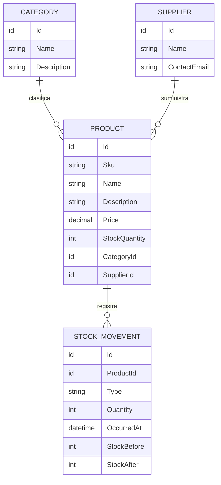

# Entity Model — ProductInventory v2.1

**Nivel:** conceptual de negocio; no define tablas, ORM, índices, clases ni tipo de ID.

## Entidades

### Product
- `Id`: identificador único.
- `Sku`: código de producto, obligatorio y único (BR-001).
- `Name`: nombre obligatorio.
- `Description`: texto opcional.
- `Price`: importe decimal no negativo; moneda fuera del alcance del MVP.
- `StockQuantity`: unidades disponibles, entero no negativo; inicia en cero. Solo cambia al registrar movimientos.
- `CategoryId`: referencia obligatoria a Category.
- `SupplierId`: referencia obligatoria a Supplier.

### Category
- `Id`: identificador único.
- `Name`: nombre obligatorio y único (comparación sin distinguir mayúsculas/minúsculas).
- `Description`: texto opcional.

### Supplier
- `Id`: identificador único.
- `Name`: nombre obligatorio; **no se exige unicidad**.
- `ContactEmail`: correo opcional con formato válido.

### StockMovement (InventoryMovement)
- `Id`: identificador único del movimiento.
- `ProductId`: producto existente al que corresponde el movimiento.
- `Type`: `IN` (entrada) o `OUT` (salida).
- `Quantity`: cantidad entera estrictamente positiva.
- `OccurredAt`: fecha y hora del registro (UTC).
- `StockBefore`: existencias anteriores al movimiento.
- `StockAfter`: existencias posteriores al movimiento.

Los movimientos son inmutables en el MVP. No se gestionan compras, ventas, reservas ni múltiples almacenes.

## Relaciones
- Una **Category** clasifica cero o muchos **Product**; cada Product pertenece a exactamente una Category.
- Un **Supplier** suministra cero o muchos **Product**; cada Product tiene exactamente un Supplier principal.
- Un **Product** registra cero o muchos **StockMovement**; cada StockMovement pertenece a exactamente un Product.
- La eliminación de Category o Supplier está prohibida si existen Product asociados.
- No se puede eliminar un Product con movimientos históricos; no se eliminan movimientos en cascada.

## Glosario
- **SKU:** identificador comercial único de producto.
- **Existencias:** unidades disponibles del producto; no se modelan almacenes ni reservas.
- **Movimiento de inventario:** entrada o salida registrada con cantidad positiva; modifica existencias de forma atómica.
- **Proveedor principal:** único proveedor asociado a un producto en este MVP.

## Decisiones de alcance
- No hay entidad Inventory separada: `StockQuantity` pertenece a Product.
- StockMovement es obligatorio por el enunciado de la prueba; representa el historial mínimo de entradas y salidas.
- La identidad del consumidor de la API es externa al dominio; no se modela User.
